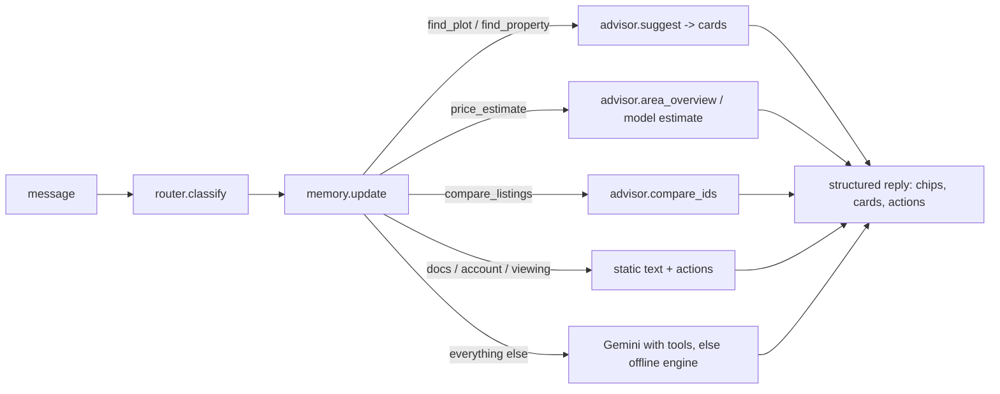

# Chatbot

One turn = `POST /api/v1/chat` → `ChatService.reply()` (`backend/services/chat_service.py`).



## Pieces
| File | Role |
|---|---|
| `services/router.py` | Rule-based intent + specialist name (`price_estimate`, `market_compare`, `find_plot`, `find_property`, `compare_listings`, `document_verification`, `buying_process`, `book_viewing`, `account`, `small_talk`, `off_topic`) |
| `services/memory.py` | Remembers area, type, budget, purpose for the session; only normalised dataset values are stored. "Start over" (`reset: true` or a new session id) clears it |
| `services/advisor.py` | Ranges with context, listing suggestions, comparisons, hand-off links. **Cards are built here from dataset rows**, never from model text, so links cannot be invented and no owner field exists to leak |
| `services/chat_service.py` | Orchestration, chips, labels (*From the dataset* / *Model estimate* / *General knowledge*) |
| `services/ai/agents_engine.py` | **OpenAI Agents SDK engine** (opt-in, `AI_ENGINE=agents`). See below |
| `services/ai/guardrails.py` | Owner-privacy check used before and inside the Agents run |
| `services/ai/errors.py` | `classify_error` (auth / quota / timeout / model / busy / network) and `redact` (strips API keys from logs and admin diagnostics) |
| `services/prompts.py` | Gemini rules (ranges, labels, one follow-up, no dead ends, memory line is data) |
| `api/chat.py` | `/chat` and `/chat/feedback` |

## Response schema
```json
{"reply": "…", "source": "offline|gemini|greeting", "from_data": true,
 "intent": "find_plot", "specialist": "Plot Finder",
 "chips":   [{"label": "Compare these plots", "message": "Compare DEMO-KPT-1 and DEMO-KPT-2"}, {"label": "Go", "url": "/login"}],
 "cards":   [{"id": "DEMO-KPT-4674", "title": "Plot in Malir, Block 3", "area": "Malir", "block": 3, "type": "Plot", "rooms": 0,
              "price": "PKR 21,400,000 (2.14 crore)", "why": ["54% below the Malir plot median (4.67 crore)"], "url": "/#/plot/DEMO-KPT-4674", "badges": ["Legal: Clear"]}],
 "actions": [{"type": "link", "label": "Message us on WhatsApp", "url": "https://wa.me/…?text=…"}],
 "memory":  {"area": "Malir", "property_type": "Plot", "block": 10}, "message_id": "…", "reason": null}
```
`reason` is `null` unless an AI engine could not answer: `no_key` (none configured), or `auth`, `quota`, `timeout`, `model`, `busy`, `network`, `error` (the last failure). Additive; older clients ignore it.
`reply/source/from_data` are unchanged, so `/api/chat` and the embeddable widget keep working.

## Deep links
`/#/plot|house|apartment|portion|commercial/<Property ID>` opens `features/listing.js` (works on refresh and when shared). The route is parsed by `routeFromHash` in `app/router.js`; the client accepts only URLs matching `SAFE_URL` in `features/chat.js`.

## Add a specialist
1. Add an `Intent` to `SPECIALISTS` and a rule in `classify` (`router.py`).
2. Put data logic in `advisor.py`; branch on the intent in `ChatService.reply`; return `text`, `cards`, `chips`, `actions`.
3. Add tests in `tests/backend/test_chat.py`.

## Feedback
`POST /api/v1/chat/feedback {message_id, rating: "up"|"down"}` stores rating, intent and the question (first 300 chars) in `chat_feedback` for admin analytics. Do not type personal data into the chat; it is kept only for this table.

## Agents SDK engine (opt-in)
`AI_ENGINE=agents` + a key (`OPENAI_API_KEY`, or `AGENTS_PROVIDER=gemini` to use `GEMINI_API_KEY` through Gemini's OpenAI-compatible endpoint). Engines are tried in `AI_ORDER` (default `agents,gemini`), then the offline engine; a failing engine falls through to the next and the reason is returned in `reason`.

* **`AGENTS_MODE=handoffs` (default):** a front-desk agent (`KPT Property Assistant`) answers simple questions and hands off to **Price Estimator** (`predict_price`, `market_stats`), **Market Analyst** (`market_stats`, `dataset_overview`) or **Property Finder** (`search_properties`, `get_property`). Each specialist only gets the tools it needs. `AGENTS_MODE=single` uses one agent with every tool.
* **Owner privacy:** a request for an owner's name/details is refused before any model call, and an SDK input guardrail repeats the check inside the run. The record store never loads owner fields, so no tool could return them anyway.
* **Resilience:** `OPENAI_MODEL=a,b` is a fallback list; one retry when the provider is busy; no retry on auth errors. Tracing is disabled. Live questions (weather, news, areas outside the data) always go to Gemini's Google Search path, never the Agents engine.
* **Diagnostics:** `/api/v1/health/detail` (admin only) shows `agents` and `gemini_status` (enabled, key present, models, why disabled, last error, redacted). The original boolean `gemini` key is unchanged.
* **Not verified against the real SDK** (it was not installable in the build sandbox): see `docs/CHATBOT_REFERENCE_COMPARISON.md`.

## Follow-ups
Memory also remembers a **block** number: after a price question, a bare `block 10` or `10` re-runs the estimate for that block. A different area clears it.
